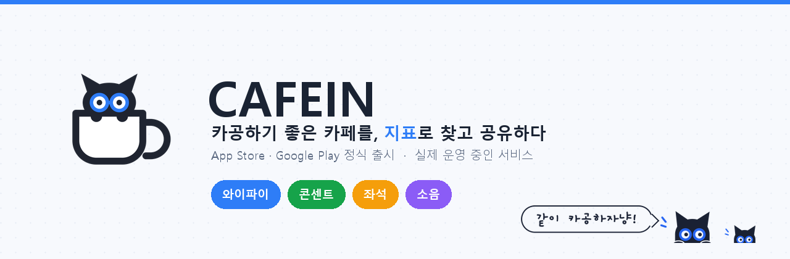
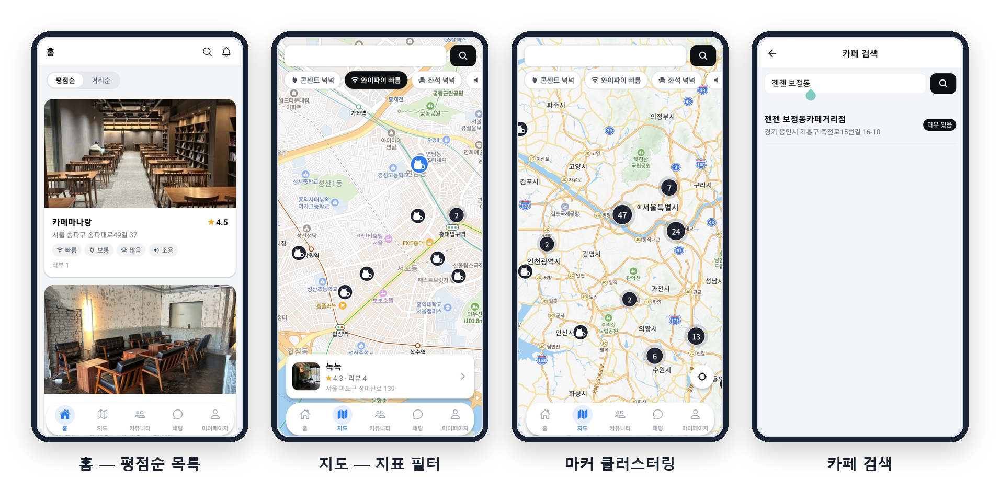
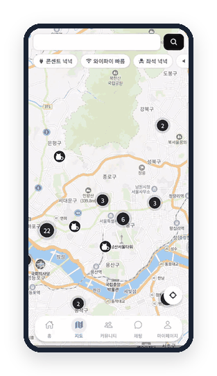
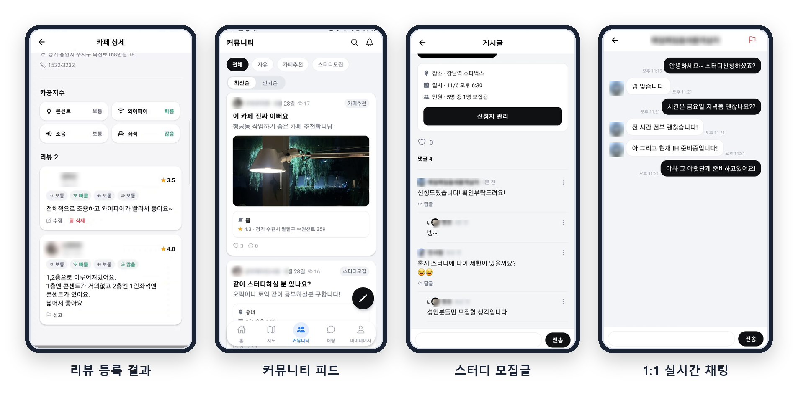
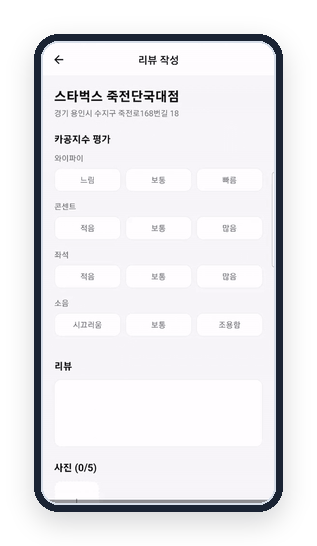
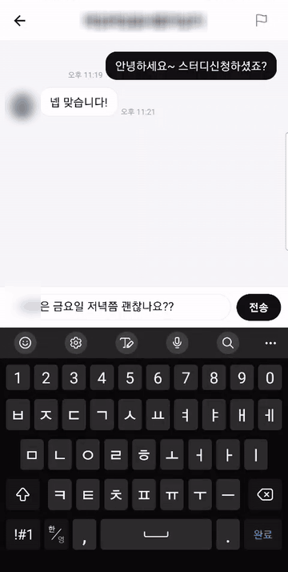
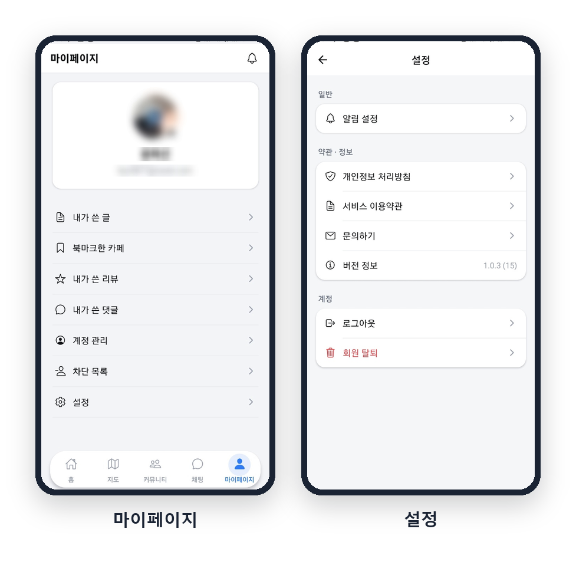
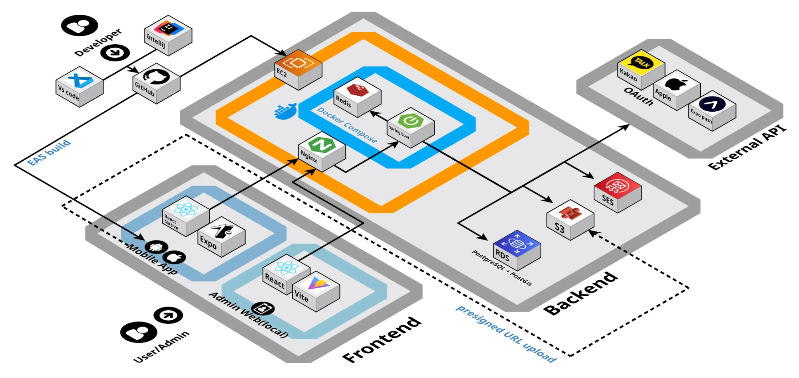
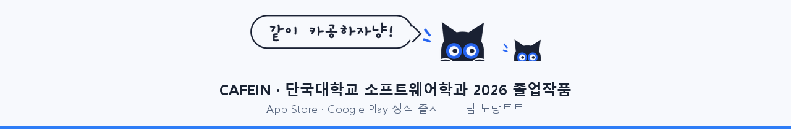

<div align="center">



<br/>

[](https://apps.apple.com/kr/app/%EC%B9%B4%ED%8E%98%EC%9D%B8-%EC%B9%B4%EA%B3%B5-%EC%B9%B4%ED%8E%98/id6805019448)
[](https://play.google.com/store/apps/details?id=com.kangungcheon.crcapp)
[](https://www.youtube.com/watch?v=lnTZRzpQXUg)
[](docs/CAFEIN_결과보고서.pdf)

**단국대학교 소프트웨어학과 2026 졸업작품** &nbsp;·&nbsp; 팀 노랑토토

카페에서 공부하는 사람(카공족)을 위해 **와이파이 · 콘센트 · 좌석 · 소음** 네 가지 지표로<br/>
카페를 찾고 공유하는 모바일 서비스입니다. 두 앱 마켓에 정식 출시되어 실제 사용자가 쓰고 있습니다.

<br/>


</div>

---

## 제출 자료

| 자료 | 링크 |
|---|---|
| **시연 영상** | https://www.youtube.com/watch?v=lnTZRzpQXUg |
| **홍보 영상** | https://www.youtube.com/watch?v=0wDHG3WVdi8 |
| **포스터** | [PDF](docs/poster/CAFEIN_poster_90x140.pdf) · [PNG](docs/poster/CAFEIN_poster_90x140.png) · [JPG](docs/poster/CAFEIN_poster_90x140.jpg) |
| **결과보고서** | [PDF](docs/CAFEIN_결과보고서.pdf) |
| **앱 내려받기** | [Google Play](https://play.google.com/store/apps/details?id=com.kangungcheon.crcapp) · [App Store](https://apps.apple.com/kr/app/%EC%B9%B4%ED%8E%98%EC%9D%B8-%EC%B9%B4%EA%B3%B5-%EC%B9%B4%ED%8E%98/id6805019448) |

| 팀 | 노랑토토 |
|---|---|
| 제출자 | 강웅천 — 단국대학교 소프트웨어학과 32210078 (전시회 개인 참가) |
| 공동 개발자 | 정주원 — 홍익대학교 (타 대학 재학으로 전시회 등록 대상 아님) |

---

| 항목 | 현황 |
|---|---|
| 서버 | `crccafe.com` — AWS 상시 운영 (앱 전용 API 서버이며 웹 페이지는 제공하지 않습니다) |
| 배포 | **App Store · Google Play 정식 출시** (v1.0.3) |
| 테스트 | 비공개 테스트 12명 이상 · 2주 이상 실사용 후 피드백 반영 → 정식 출시 |
| 플랫폼 | Android · iOS |


## 왜 출시까지 갔는가

AI 코딩 도구가 보편화되면서 **동작하는 프로토타입을 만드는 일 자체는 전보다 쉬워졌습니다.**
그래서 차이는 만드는 단계가 아니라 그다음에서 생긴다고 봤습니다.

실제 사용자를 받기 시작하면 로컬에서는 드러나지 않던 문제가 나옵니다.
개인 메일 계정으로 보내던 인증 코드가 스팸으로 분류되고,
`+태그` 주소 하나로 계정을 무한히 만들 수 있다는 것이 드러나고,
라이브러리 메이저 업그레이드가 조용히 동작을 바꿔 같은 글이 두 번 등록됩니다.
스토어 심사는 통과해야 하고, 서명 키는 한 번 어긋나면 되돌리기 어렵습니다.

**이런 문제는 배포하고 운영해야만 만납니다.**
만나야 원인을 찾고, 고치면서 구조를 다시 보게 됩니다.
저장소의 [트러블슈팅 문서](docs/troubleshooting.md) 10건 중 절반은
출시 이후에 생긴 일입니다.

CAFEIN을 프로토타입에서 멈추지 않고 두 앱 마켓에 출시해
운영까지 끌고 간 이유입니다.


## 1. 이런 문제를 풀었습니다

기존 지도·리뷰 앱의 평점은 "커피 맛"과 "분위기" 중심이라
**오래 앉아서 공부해도 되는 카페인지**는 직접 가봐야 알 수 있습니다.

CAFEIN은 카공에 필요한 정보만 구조화했습니다.

| 지표 | 선택지 |
|---|---|
| 와이파이 | 빠름 / 보통 / 느림 |
| 콘센트 | 넉넉 / 보통 / 부족 |
| 좌석 | 넉넉 / 보통 / 부족 |
| 소음 | 조용 / 보통 / 시끄러움 |

리뷰가 쌓이면 카페마다 평균 지표가 계산되고, 지도와 목록에서 **지표로 필터링**할 수 있습니다.


## 2. 화면

### 2-1. 카페 찾기

지도에서 카공 지표로 필터링하고, 검색이나 마커 선택으로 카페 상세를 확인합니다.
카페가 많은 지역은 클러스터로 묶어 표시합니다.



<div align="center">
  <br/>
  <sub><b>시연</b> — 지도 탐색 · 검색 · 마커 선택 · 카페 상세</sub>
</div>

### 2-2. 리뷰 · 커뮤니티 · 채팅

지표 4종을 선택해 리뷰를 남기면 카페 평균 지표에 바로 반영됩니다.
커뮤니티에서 스터디원을 모으고, 1:1 채팅으로 바로 연결됩니다.



<div align="center">
  
  &nbsp;&nbsp;
  <br/>
  <sub><b>시연</b> — 리뷰 작성 (왼쪽) · 1:1 실시간 채팅 (오른쪽)</sub>
</div>

### 2-3. 계정

<div align="center">
  
</div>

> 닉네임, 프로필 이미지, 이메일 등 개인을 식별할 수 있는 정보는 블러 처리했습니다.


## 3. 주요 기능

### 카페
- 네이버 지도 기반 카페 탐색, 마커 클러스터링
- 현재 위치 기준 거리순 정렬 (PostGIS 공간 쿼리)
- 카공 지표 4종 필터, 카페/동네 검색 (카카오 로컬 API 연동)
- 카페 상세: 사진, 평점, 리뷰 목록, 북마크

### 리뷰
- 카공 지표 4종 + 사진 첨부(최대 5장) 리뷰 작성/수정/삭제
- 한 카페당 1인 1리뷰, 수정 시 기존 사진 유지

### 커뮤니티
- 피드 작성/수정/삭제, 좋아요, 댓글, 조회수(하루 1회 집계)
- **스터디 모집**: 장소·시간·정원을 지정해 모집하고 신청/수락 처리
- 사용자 프로필, 차단, 신고

### 채팅
- WebSocket(STOMP) 기반 1:1 실시간 채팅
- 안 읽은 메시지 배지, 상대가 오프라인이면 푸시 알림 발송

### 계정
- 이메일 가입(인증코드 메일 발송) / 카카오 / 애플 / 네이버 로그인
- JWT 기반 인증(access + refresh), 비밀번호 재설정, 회원 탈퇴
- 이메일 별칭(`+태그`, gmail 점) 중복 가입 차단

### 관리자 웹
- 신고 처리, 사용자 정지 관리, 카페 대표 이미지 관리


## 4. 시스템 구조



**Frontend**
- **모바일 앱 (React Native + Expo)**: 사용자용 Android/iOS 앱. EAS Build로 빌드해 스토어에 배포
- **관리자 웹 (React + Vite)**: 신고 처리, 이용 정지, 카페 이미지 관리

**Backend** — AWS EC2에서 Docker Compose로 운영
- **Nginx**: 리버스 프록시. HTTPS를 처리하고 내부 8080 포트로 요청 전달 (백엔드 포트는 외부에 노출하지 않음)
- **Spring Boot**: REST API와 WebSocket(STOMP) 서버. 인증, 도메인 로직, 외부 API 연동 담당
- **Redis**: 리프레시 토큰, 로그아웃 토큰 블랙리스트, 회원가입 인증코드(TTL 5분), 요청 수 제한
- **RDS (PostgreSQL + PostGIS)**: 영구 데이터 저장. 위치 기반 조회는 PostGIS 공간 쿼리로 처리하며, 스키마는 Flyway로 버전 관리
- **S3**: 리뷰·피드·프로필 이미지. 앱이 presigned URL로 직접 업로드해 서버를 거치지 않음
- **SES**: 회원가입 인증코드와 비밀번호 재설정 메일 발송 (`noreply@crccafe.com`)

**External API**
- **카카오 로컬 API**: 카페 검색 및 위치 정보
- **카카오 / 애플 / 네이버 로그인**: 소셜 인증. 각 제공자 토큰을 검증한 뒤 자체 JWT 발급
- **Expo Push**: 채팅·댓글 등 알림 발송

**개발 흐름**
- 로컬(VS Code / IntelliJ) → GitHub Pull Request → `main` 머지 → EC2에서 pull 후 재배포

### 설계 포인트
- **이미지 업로드**: 서버를 거치지 않고 앱이 S3 presigned URL로 직접 업로드 → 서버 부하·트래픽 절감
- **인증**: access/refresh 토큰 분리, 로그아웃 토큰은 Redis 블랙리스트로 차단
- **인증 메일**: 가입 요청 시점에는 유저를 만들지 않고 Redis에 5분 TTL로 보관, 코드 검증에 성공해야 DB INSERT
- **스키마 관리**: Flyway로 버전 관리(V1~V11), 서버 기동 시 자동 마이그레이션
- **지도 성능**: supercluster로 마커를 클러스터링해 카페가 많아도 프레임 드랍 없이 렌더링


## 5. 기술 스택

| 영역 | 사용 기술 |
|---|---|
| 모바일 앱 | React Native, Expo SDK 54, React Navigation 7, @mj-studio/react-native-naver-map, supercluster |
| 백엔드 | Java 17, Spring Boot, Spring Security, JPA/Hibernate, WebSocket(STOMP), Flyway, springdoc(OpenAPI) |
| 데이터 | PostgreSQL + PostGIS (AWS RDS), Redis |
| 인프라 | AWS EC2, S3, SES, Nginx, Docker Compose, Let's Encrypt |
| 관리자 웹 | React 18, Vite, Ant Design |
| 배포 | EAS Build → App Store · Google Play / GitHub PR → EC2 재배포 |


## 6. 디렉터리 구조

```
.
├── app/        모바일 앱 (React Native + Expo)
├── admin/      관리자 웹 (React + Vite)
└── docs/       설계 문서, 아키텍처, ERD, 화면 캡처
```

각 디렉터리의 실행 방법은 해당 폴더 README를 참고하세요.

| 문서 | 내용 |
|---|---|
| [docs/requirements.md](docs/requirements.md) | 요구분석명세서 — 기능 요구사항 82건 |
| [docs/screens.md](docs/screens.md) | 화면별 기능 확인서 — 화면 41종의 구성·이동·데이터 |
| [docs/architecture.md](docs/architecture.md) | 시스템 구조와 요청 흐름 |
| [docs/erd.md](docs/erd.md) | 데이터 모델 (ERD) |
| [docs/api.md](docs/api.md) | API 설계, 인증 정책, 요청 제한 |
| [docs/troubleshooting.md](docs/troubleshooting.md) | 개발·운영 중 겪은 문제 10건과 해결 과정 |

### 백엔드 소스가 저장소에 없는 이유

CAFEIN은 **실제 사용자가 이용 중인 서비스**입니다.
서버 구현(인증 처리, 권한 검사, 쿼리 구조)이 공개되면 운영 중인 서비스와 사용자 데이터에
직접적인 위험이 생기기 때문에, 백엔드 소스는 비공개 저장소로 운영하고 있습니다.

대신 백엔드의 설계와 구현 내용은 위 문서 네 건으로 확인하실 수 있도록 정리했습니다.
구조, 데이터 모델, API 설계와 인증 정책, 실제 트러블슈팅 과정이 모두 포함되어 있습니다.

**평가를 위해 백엔드 소스 확인이 필요하시면, 요청하신 범위를 압축 파일로 제출하겠습니다.**
결과보고서에 기재된 연락처로 말씀해 주시면 바로 보내드리겠습니다.


## 7. 보안 처리

- 모든 비밀값(DB 계정, JWT 시크릿, AWS 키, 메일 계정)은 서버 환경변수(`.env`)로만 주입하며, 저장소에는 예시 파일(`.env.example`, `application.yaml.example`)만 둡니다.
- 앱에 포함되는 지도·소셜 SDK 키는 공개를 전제로 한 클라이언트 키이며, **패키지명과 키 해시로 사용 범위를 제한**했습니다.
- 이미지 업로드는 presigned URL로 폴더·확장자를 서버에서 검증한 뒤 발급합니다.
- 인증 코드 발송·검증에 횟수 제한과 쿨다운(Redis)을 적용했습니다.


## 8. 개발 및 배포

- 기능 단위 브랜치 → Pull Request → 코드 리뷰 → `main` 머지
- 서버는 `main`을 pull 하여 Docker Compose로 재빌드 배포
- 앱은 EAS Build(클라우드)로 AAB를 생성해 Google Play에 업로드


## 9. 참여자 및 역할

타 학교 재학생과 2인 팀으로 개발했습니다.

| 영역 | 담당 |
|---|---|
| 기획 · 설계 | 공동 |
| 백엔드 (API, DB, 인증, 채팅, 이미지 처리) | 공동 |
| 모바일 앱 (화면, 지도, 리뷰·커뮤니티, 채팅 UI) | 공동 |
| 관리자 웹 | 협업 개발자 |
| 인프라 · 배포 (AWS EC2 · RDS · S3 · SES, Nginx, 도메인/HTTPS) | 강웅천 |
| 디자인 (로고, 앱 아이콘, UI) | 협업 개발자 |
| 앱 빌드 · 배포 — App Store | 협업 개발자 |
| 앱 빌드 · 배포 — Google Play | 강웅천 |

> 개발은 기능 단위 브랜치와 Pull Request로 진행했습니다.
> 백엔드 약 270개, 앱 약 190개의 커밋이 두 사람의 리뷰를 거쳐 머지되었습니다.

> 이 저장소는 졸업작품 제출용으로 정리한 스냅샷입니다.
> 개발 과정의 커밋/PR 기록(총 471개 커밋)과 백엔드 소스는 비공개 원본 저장소에 있으며, 요청 시 해당 범위를 압축 파일로 제출하겠습니다.

<div align="center">



</div>
