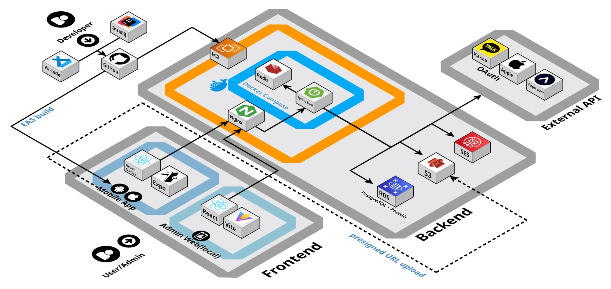
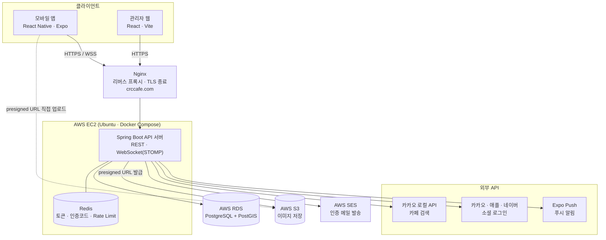
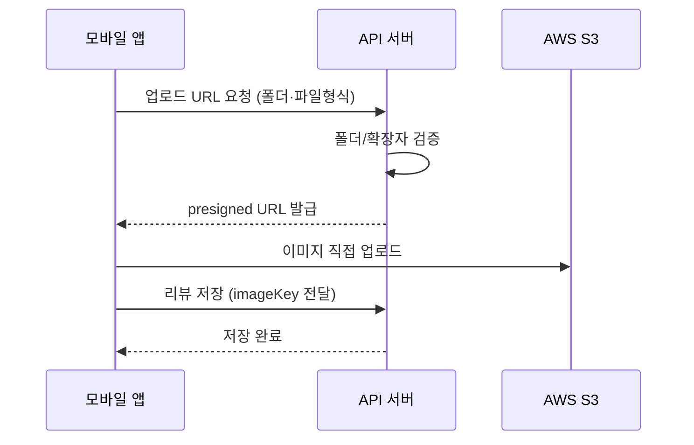
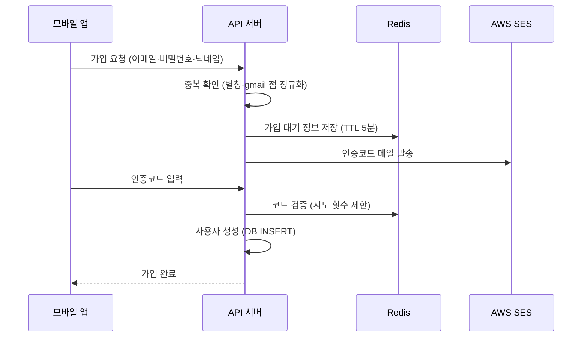
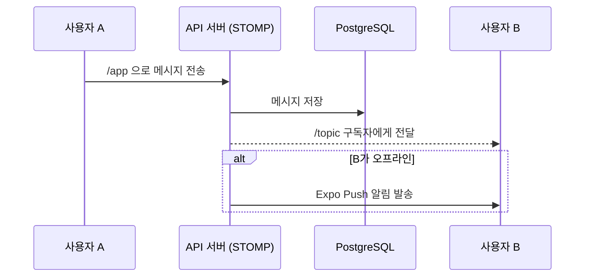

# 시스템 아키텍처

## 전체 구조

## 요청 흐름

### 이미지 업로드
서버를 거치지 않고 앱이 S3에 직접 올려 서버 부하와 트래픽을 줄였습니다.

### 이메일 회원가입
인증에 성공해야 사용자 레코드를 만들기 때문에, 미인증 계정이 DB에 쌓이지 않습니다.

### 실시간 채팅
상대가 접속 중이면 WebSocket으로 즉시 전달하고, 아니면 푸시로 알립니다.

## 설계 시 고려한 점

| 항목 | 선택 | 이유 |
|---|---|---|
| 이미지 업로드 | S3 presigned URL | 서버를 경유하지 않아 트래픽·메모리 부담이 없음 |
| 위치 기반 조회 | PostGIS 공간 쿼리 | 거리 계산을 DB에서 처리해 전체 조회 후 정렬하는 방식보다 효율적 |
| 지도 렌더링 | supercluster 클러스터링 | 카페 수가 늘어도 마커 렌더링 비용이 일정하게 유지됨 |
| 토큰 관리 | access + refresh 분리, Redis 블랙리스트 | 짧은 만료로 탈취 위험을 줄이고 로그아웃 토큰을 즉시 차단 |
| 인증코드 저장 | Redis TTL | 만료 처리를 DB 정리 작업 없이 자동화 |
| 스키마 관리 | Flyway | 서버 기동 시 자동 마이그레이션, 버전으로 이력 추적 |
