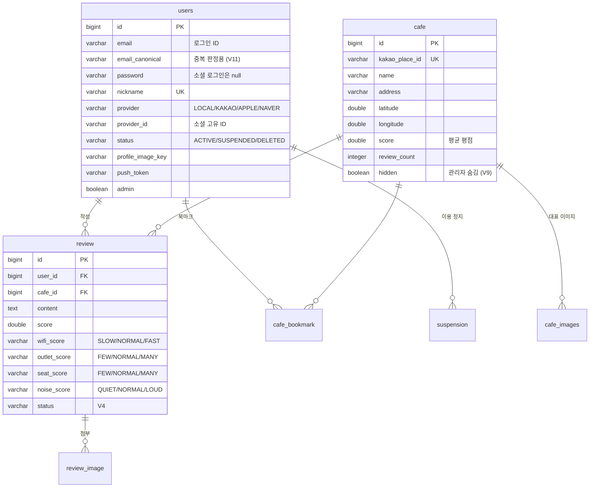
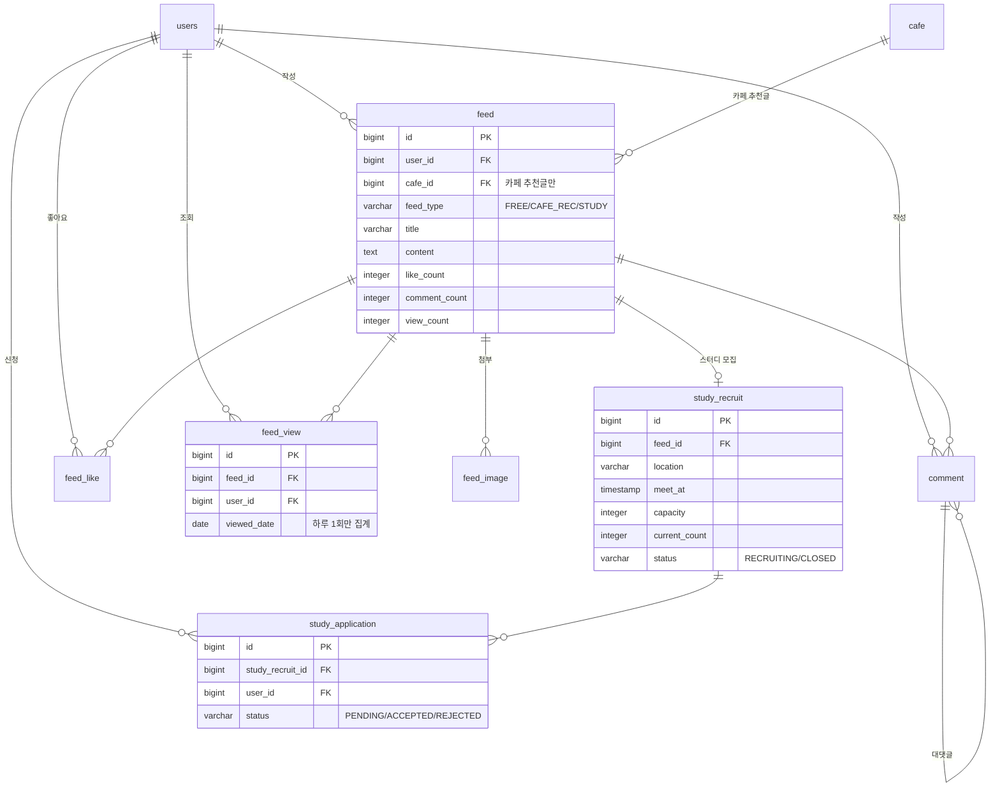
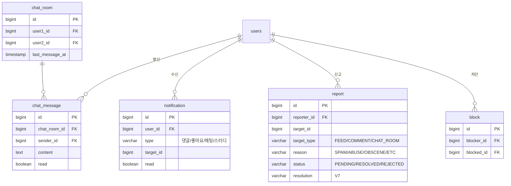

# 데이터베이스 ERD

PostgreSQL + PostGIS. 스키마는 Flyway로 관리하며 현재 V11까지 적용되어 있습니다.
(`backend/src/main/resources/db/migration/`)

## 사용자 · 카페 · 리뷰

## 커뮤니티 · 스터디

## 채팅 · 알림 · 신고

## 마이그레이션 이력

| 버전 | 내용 |
|---|---|
| V1 | 초기 스키마 |
| V2 | 레거시 image_url 컬럼 제거 |
| V3 | 인덱스 추가 |
| V4 | 리뷰 상태 컬럼 |
| V5 | 이용 정지(suspension) 테이블 |
| V6 | 신고 대상 타입 제약 수정 |
| V7 | 신고 처리 결과 컬럼 |
| V8 | 푸시 토큰 컬럼 |
| V9 | 카페 출처·숨김 컬럼 |
| V10 | 탈퇴 시 소셜 provider_id 해제 |
| V11 | 이메일 별칭 중복가입 차단용 email_canonical |
